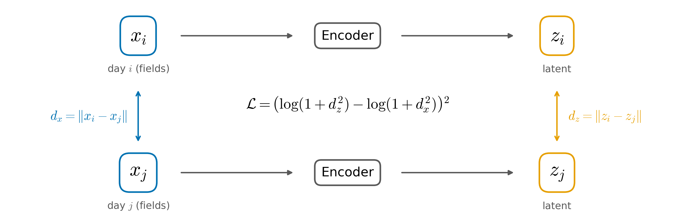
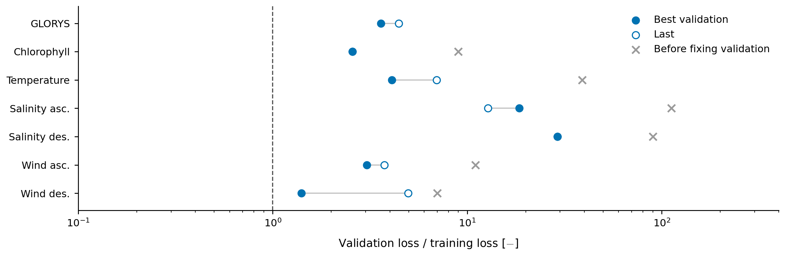
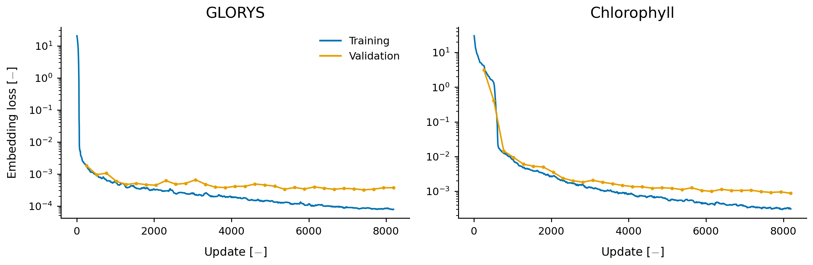
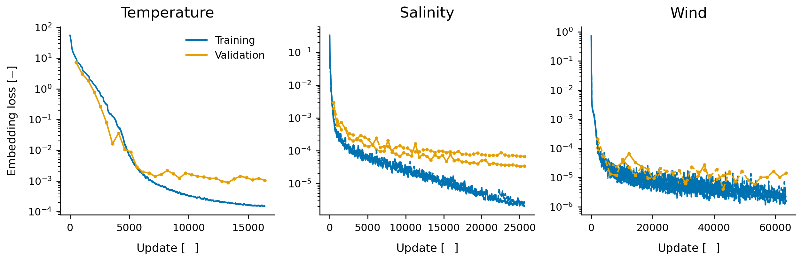

<!-- _class: title -->
<!-- _paginate: false -->

<video class="bg" src="../../media/title/background.mp4" poster="../../media/title/poster.jpg" autoplay loop muted playsinline></video>

Credits: Gilles Louppe

Understanding the Ocean from Observations Using Deep Learning

<b>PRESENTED BY</b>
Victor Mangeleer1–4

<b>PHD SUPERVISORS</b>
Marilaure Grégoire1,3 and Gilles Louppe2,3
<b>HOST SUPERVISOR</b>
Laure Zanna4
<b>IN AFFILIATION WITH</b>
Modelling for Aquatic Systems1, Science with AI Laboratory2, 
University of Liège3, New York University4.

---

<!-- _class: project -->

# What can we predict from space?

---

<!-- _class: video -->

<video class="full" src="../../projects/what-can-we-predict-from-space/1-questions.mp4" poster="../../projects/what-can-we-predict-from-space/1-questions.jpg" muted playsinline preload="auto"></video>

---

<!-- _class: video -->

<video class="full" src="../../projects/what-can-we-predict-from-space/2-methodology.mp4" poster="../../projects/what-can-we-predict-from-space/2-methodology.jpg" muted playsinline preload="auto"></video>

---

<!-- _class: video -->

<video class="full" src="../../projects/what-can-we-predict-from-space/3-architecture.mp4" poster="../../projects/what-can-we-predict-from-space/3-architecture.jpg" muted playsinline preload="auto"></video>

---

# Progress

Since our last meeting, here is what we worked on:

- Cleaning, standardizing and copying the datasets on Torch, with **GLORYS coarsened by a factor $4$**.
- A fixed validation, automatic stopping and resuming, and $3\times$ faster updates\*.
- We finally finished training the $7$ encoders, and *all their latents are already saved* on Torch ($90$ GB).

* Sea surface temperature encoder on one H200, 32 days per update: 2.96 s with the setup of the first trainings, 0.99 s with torch.compile, channels last and no activation checkpointing.

---

## What the loss of the encoders compares

Each encoder is trained with a **Gromov-Monge embedding** loss: for every pair of days in a batch, the distance between their latents must match the distance between their fields. Now, the encoders have been changed:

- *no mask* as input;
- *no date* as input;
- the convolutions are **periodic along the longitude** (it helped in our experiments).

---

<!-- _class: result -->

<b>Figure A.</b> Two days $x_i$ and $x_j$ are encoded into $z_i$ and $z_j$, and the loss compares *their distances*.

**Key result.** One loss for every dataset, which only compares distances between days.

Credits: Lee, <a href="https://arxiv.org/abs/2501.09876">Geometry-preserving encoder/decoder in latent generative models</a>, 2026.

---

## A fixed validation

The validation now uses the *same days* at every evaluation, spread over $2022$–$2023$ ($512$ days for the observations, $128$ for GLORYS). We keep the **best validation** model, stop when the loss stops improving, and resume a job automatically when it is cut. We then evaluated each encoder on the whole validation and on as many training days: the results are in the next figure.

---

<!-- _class: result -->

<b>Figure B.</b> Validation loss over training loss, now and before fixing the validation: *closer to $1$ than before*.

**Key result.** The validation loss now reflects much more faithfully what the encoders can do.

---

## Training of the seven encoders

Each encoder sees $32$ days per update ($16$ for GLORYS), on one GPU for the observations and on two GPUs for GLORYS and the chlorophyll\*. All $7$ encoders finished, and their **best validation** models encoded every training and validation day.

* NVIDIA RTX Pro 6000 GPUs, with 102 GB of memory each; GLORYS ran on two NVIDIA B200.

---

<!-- _class: result -->

<b>Figure C.</b> Training (running median) and validation losses of GLORYS and the chlorophyll: *both still decrease*.

---

<!-- _class: result -->

<b>Figure D.</b> Same for temperature, salinity and wind (solid: ascending passes, dashed: descending): *salinity drifts apart*.

Salinity and wind have two encoders each, one for the ascending passes of the satellites and one for the descending passes, hence two validation curves.

---

## Summary

**Key results**

1. One loss for every dataset, on distances only.
1. A validation that reflects what the encoders can do.

**Problems to solve**

1. Salinity overfits its training data.
1. A retraining with a more frequent validation stopped too early, so we kept the first models.

---

<!-- _class: dark -->

## What's next

- Train the processor on the latents, with the observations and the states outside the observation windows as inputs.

---

## Sources

- shaggy, training tools, autoencoders and the embedding loss: [github.com/VikVador/Shaggy](https://github.com/VikVador/Shaggy)
- PyTorch, networks and distributed training: [github.com/pytorch/pytorch](https://github.com/pytorch/pytorch)
- Weights & Biases, training curves: [github.com/wandb/wandb](https://github.com/wandb/wandb)
