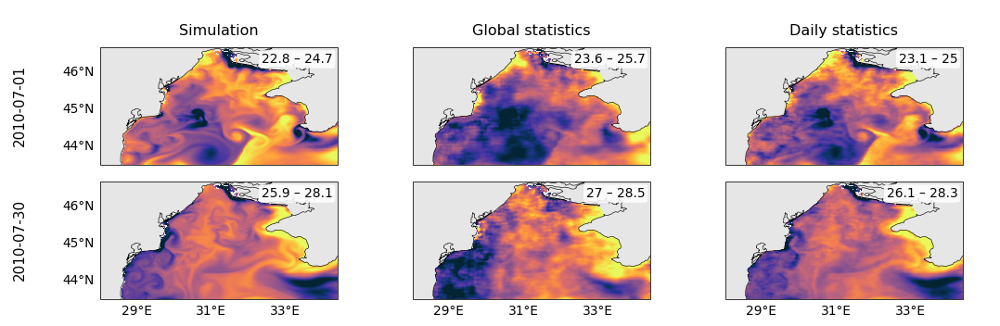
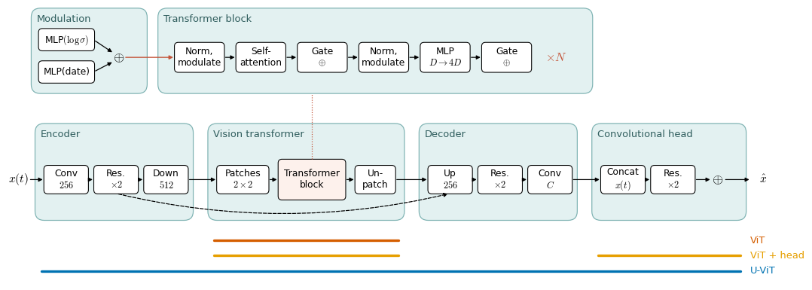
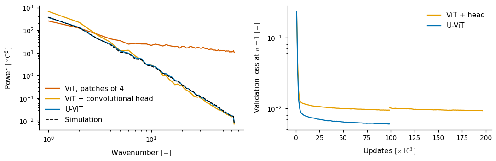
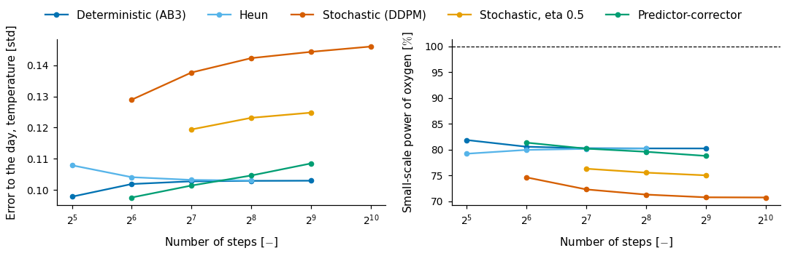
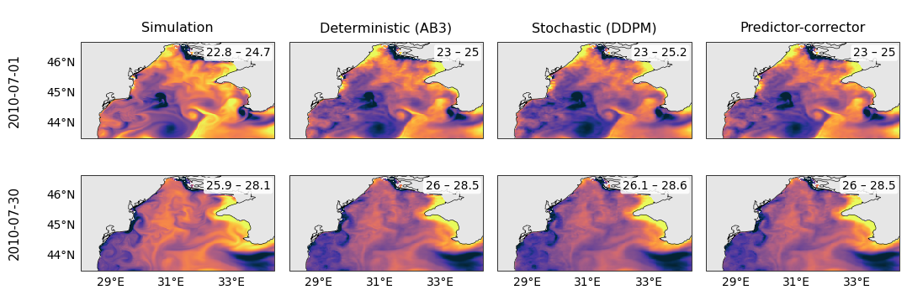

<!-- _class: title -->
<!-- _paginate: false -->

<video class="bg" src="../../media/title/background.mp4" poster="../../media/title/poster.jpg" autoplay loop muted playsinline></video>

Poseidon: Three Changes for a better Prior

<b>PRESENTED BY</b>
Victor Mangeleer1–4

<b>PHD SUPERVISORS</b>
Marilaure Grégoire1,3 and Gilles Louppe2,3
<b>HOST SUPERVISOR</b>
Laure Zanna4
<b>IN AFFILIATION WITH</b>
Modelling for Aquatic Systems1, Science with AI Laboratory2, 
University of Liège3, New York University4.

---

# Progress

We want to *improve the results* of the paper, and learn what works best for our other projects:

- **Rewrite**: Poseidon rebuilt on azula, on the shelf and with the variables of the paper.
- **Overfit study**: $90$ days of summer 2010, to check that the prior can produce realistic states.
- **Mutation-style search**: many runs, sometimes from scratch, but often from the best one with one change, *reusing its weights* to save time.

Credits: Mangeleer et al., <a href="https://arxiv.org/abs/2604.25608">The physical limit of neural hypoxia detection in the Black Sea from satellite observations</a>, 2026.

---

## Daily standardization

In the paper, each channel is standardized by a mean and a standard deviation computed **over all days**. In summer, the eddies of the day ($1$ to $2\,^\circ\mathrm{C}$) are then a small fraction of a $7\,^\circ\mathrm{C}$ deviation. Instead, we standardized each state by the **statistics of its day of the year**:

| Surface, 1 July | Global statistics | Daily statistics |
|---|---|---|
| Temperature [$^\circ\mathrm{C}$] | $15.9 \pm 7.0$ | $23.5 \pm 2.2$ |
| Oxygen [$\mathrm{mmol\,m^{-3}}$] | $285 \pm 36$ | $255 \pm 14$ |

We took the ViT trained from scratch for $64$k updates on global statistics, and trained it for $98$k more updates on daily statistics.

---

<!-- _class: result -->

<b>Figure A.</b> Surface temperature [$^\circ\mathrm{C}$], each map with its own $2$–$98\,\%$ quantiles.

Note: the daily ViT also trained longer; a fair test would train both from scratch for as many updates. The filaments appeared within 16k updates.

---

## From a U-Net to a ViT, then a U-ViT

Here we explore a **vision transformer** (ViT), which turns each patch of $4 \times 4 \times 129 = 2064$ values into one token of $1024$ features. Its prior samples $\tilde{x} \sim p_\theta(x)$ showed the *grid of the patches*, so we added a **convolutional head** after the ViT, at full resolution, to smooth these discontinuities.

We then added a convolutional **encoder** before the ViT, which coarsens the states once, so that the tokens are built from learned features rather than raw pixels, and a **decoder** after it: the ViT becomes the bottleneck of a U-Net, the **U-ViT**.

---

<!-- _class: result -->

<b>Figure B.</b> The U-ViT; the coloured lines show which parts make the ViT, the ViT with its head, and the U-ViT.

---

<!-- _class: result -->

<b>Figure C.</b> Spectrum of surface temperature, mean of $6$ generated days; validation loss along each training.

**Key result.** The U-ViT follows the simulated spectrum, and goes below the plateau the ViT kept for about $200$k updates.

---

## Samplers

We were curious whether the remaining blur comes from the **sampler**. With the U-ViT ($60$k updates), we generated two memorized days from the same initial noise with the samplers of azula: **deterministic** (Adams–Bashforth of order $3$, Heun), **stochastic** (DDIM with $\eta = 0.5$, DDPM) and **predictor-corrector** (one Langevin correction per step), from $32$ to $1024$ steps.

---

<!-- _class: result -->

<b>Figure D.</b> Error to the memorized day (temperature) and small-scale power of oxygen (wavenumbers $\geq 20$, simulation $= 100\,\%$).

**Key result.** The deterministic sampler of order $3$ does best: the lowest error and the most small-scale power.

---

<!-- _class: result -->

<b>Figure E.</b> Surface temperature [$^\circ\mathrm{C}$] from the same initial noise, $256$ steps, each map with its own scale.

**Problem.** The same slight blur with every sampler: it does not come from the sampler, but from the denoiser.

---

## Other changes

**Also helped**

1. Input projection in float32: $0.93 \to 0.83$ at $\sigma = 10^{-3}$.
1. Learning rate $5 \times 10^{-4}$, and a wider ViT ($1024$, $16$ blocks).
1. Fine-tuning from the best weights at each change.

**Did not help**

1. Patches of $2$ or $1$: slower, worse at $\sigma = 0.1$–$1$.
1. Date as input channels: equal or worse.
1. Float32, $\sigma_{\min} = 10^{-6}$, more low-noise training: no change.
1. Variance exploding schedule: better at the extremes, worse at $\sigma = 0.1$–$1$.

---

## Summary

**Key results**

1. The U-ViT follows the simulated spectrum.
1. The deterministic sampler of order $3$ does best.

**Problems to solve**

1. A slight blur remains, from the denoiser: $80\,\%$ of the small-scale power of oxygen.

---

<!-- _class: dark -->

## What's next

- **Sharper samples**: more depth and more channels at full resolution (runs in progress).
- **Full training**: the chosen U-ViT on 1998–2017, on $8$ A100.
- **Posterior**: skill, spread and SSR per depth, and hypoxia, as in the paper.
