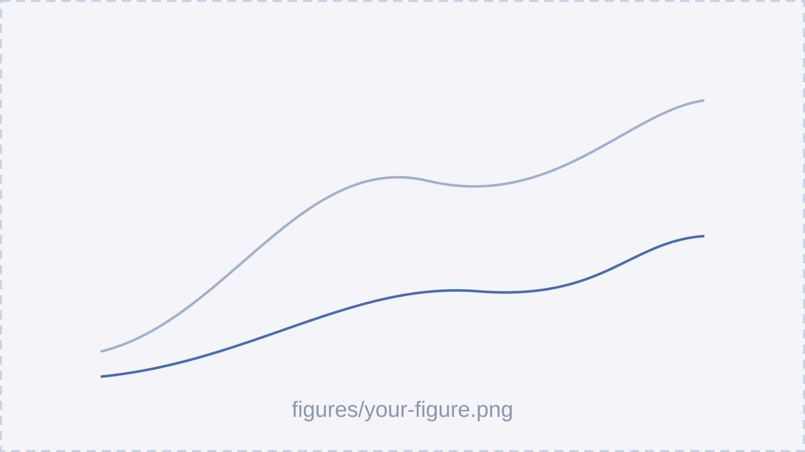
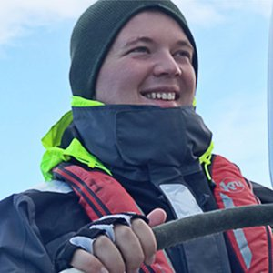

<!-- _class: title -->
<!-- _paginate: false -->

<!--
RULE · TITLE SLIDE 1/2 · WITH EVERYONE (default)
Every deck opens with one of the two title slides, copied exactly. This one, the default: the presenter block, then one block with the PhD supervisors, the host supervisor and the affiliations (on two lines), each block with its own vertical rule.
The title is the thesis title, unless a new title was asked: then only the title text changes. Title Case for the thesis title only; every other title of the deck is in sentence case. Never change the names, the superscripts, the background video or its credit (Gilles Louppe, bottom-left of the animation). No date, no meeting name, no logo on it.
-->

<video class="bg" src="media/title/background.mp4" poster="media/title/poster.jpg" autoplay loop muted playsinline></video>

Credits: Gilles Louppe

Understanding the Ocean from Observations Using Deep Learning

<b>PRESENTED BY</b>
Victor Mangeleer1–4

<b>PHD SUPERVISORS</b>
Marilaure Grégoire1,3 and Gilles Louppe2,3
<b>HOST SUPERVISOR</b>
Laure Zanna4
<b>IN AFFILIATION WITH</b>
Modelling for Aquatic Systems1, Science with AI Laboratory2, 
University of Liège3, New York University4.

---

<!-- _class: title -->
<!-- _paginate: false -->

<!--
RULE · TITLE SLIDE 2/2 · PRESENTER ALONE
Same slide without the supervisors: the presenter block, then the affiliations only (all four, superscripts unchanged), and the same credit of the animation. Use it only when asked.
-->

<video class="bg" src="media/title/background.mp4" poster="media/title/poster.jpg" autoplay loop muted playsinline></video>

Credits: Gilles Louppe

Understanding the Ocean from Observations Using Deep Learning

<b>PRESENTED BY</b>
Victor Mangeleer1–4

<b>IN AFFILIATION WITH</b>
Modelling for Aquatic Systems1, Science with AI Laboratory2, 
University of Liège3, New York University4.

---

<!-- _class: project -->

<!--
RULE · PROJECT SLIDE
Opens each project of the deck: class `project`, the project title alone as an `# h1` on one line, centred on the slide, and the logo of its university in the top-right corner (``, ``).
A project of `projects/` takes its title and logo from its `project.yaml`, and its recap videos follow. A new project (a title and a university given by the user) has this slide alone, no video. A deck without project has no project slide: it starts with its Progress slide, or directly with its experiments.
-->

# What can we predict from space?

---

<!-- _class: video -->

<!--
RULE · PROJECT RECAP (here: projects/what-can-we-predict-from-space/)
Every project of `projects/` has a folder with its recap videos and a `project.yaml` (title, university, logo, paper, videos in order). A recapped project shows all its videos, never a subset, in the order of `videos`, one full-screen slide each (class `video`), right after its project slide.
No title on the videos (the project slide carries it); the university logo top-right on each.
Play/pause: button bottom-left, or click on the animation. Videos restart when their slide is entered.
-->

<video class="full" src="projects/what-can-we-predict-from-space/1-questions.mp4" poster="projects/what-can-we-predict-from-space/1-questions.jpg" muted playsinline preload="auto"></video>

---

<!-- _class: video -->

<video class="full" src="projects/what-can-we-predict-from-space/2-methodology.mp4" poster="projects/what-can-we-predict-from-space/2-methodology.jpg" muted playsinline preload="auto"></video>

---

<!-- _class: video -->

<video class="full" src="projects/what-can-we-predict-from-space/3-architecture.mp4" poster="projects/what-can-we-predict-from-space/3-architecture.jpg" muted playsinline preload="auto"></video>

---

<!-- _class: project -->

# Neural emulator of Black Sea dynamics

---

<!-- _class: video -->

<!--
RULE · PROJECT RECAP (here: projects/neural-emulator-of-black-sea-dynamics/)
Same rule for every project: its project slide, then all its videos in order.
-->

<video class="full" src="projects/neural-emulator-of-black-sea-dynamics/1-questions.mp4" poster="projects/neural-emulator-of-black-sea-dynamics/1-questions.jpg" muted playsinline preload="auto"></video>

---

<!-- _class: video -->

<video class="full" src="projects/neural-emulator-of-black-sea-dynamics/2-architecture.mp4" poster="projects/neural-emulator-of-black-sea-dynamics/2-architecture.jpg" muted playsinline preload="auto"></video>

---

# Section title

A part of the talk opens with an `# h1` pinned at the top, on the left margin.

<b>Section title.</b> <code># h1</code> opens a part of the talk (e.g. <code># Progress</code>); only the first slide of the part has it. Whatever follows still starts on the <b>text line</b> (1/3). Sizes always decrease: <code>#</code> 40 pt › <code>##</code> 26 pt › text 17 pt.

---

## Sub-title

Inside a part, an `## h2` names a sub-part, for example one experiment.

<b>Sub-title.</b> <code>## h2</code> sits on the <b>sub-title line</b> (1/4), on one line, in sentence case; the text starts on the <b>text line</b> (1/3). For example the name of an experiment, on its analysis slide (see Experiment 1/3).

---

The model never sees in-situ profiles during inference. Everything below the surface is inferred from SST, SSS, SSH and chlorophyll.

<b>Text slide.</b> A slide without title (text, explanation): the text starts on the <b>text line</b> (1/3), never higher. One idea per slide, written as one or two full sentences, always justified.

---

The emulator is a **latent diffusion model**: we test whether its forecasts stay *more accurate than CMEMS* up to 11 days, starting from an initial state $x_t$ estimated from [satellite observations](https://marine.copernicus.eu).

<b>Colours.</b> Each colour of the palette has one job. <b>Bold</b> (primary, dark blue): a concept named for the first time. <code>*Italic*</code> (secondary, coral): the 1–2 words per slide that carry the message, the same role as the coral words in the animations (e.g. <i>atmospheric forcing</i>, the new element of the scene). Coral is also the colour of the Choice box. Highlight blue: maths, numbers, links and labels only, never for emphasis. Red: only in the Problem box and the problems of the summary.

---

We frame reconstruction as a **Bayesian inverse problem**: we want the **posterior** over the ocean state $x$ given the surface observations $y$,

$$
p(x \mid y) \;\propto\; p(y \mid x)\, p(x),
$$

where $p(y \mid x)$ is the **observation model** and $p(x)$ is the **prior**, learned by a latent diffusion model.

<b>Maths 1/3 · writing.</b> All maths is written in LaTeX: <code>$...$</code> inline, <code>$$...$$</code> for a display equation. Never as plain text, not even a single symbol or number with a unit. Symbols render in the highlight colour. Each symbol is introduced next to its meaning in <b>bold</b>, so the slide reads in words as well as in maths. Display equations end with a comma or a full stop.

---

| What | LaTeX | Renders |
|---|---|---|
| Variables: state, observations, forcing | `x, y, c` | $x$, $y$, $c$ |
| Time index, always as a subscript | `x_t, x_{t+1}` | $x_t$, $x_{t+1}$ |
| Sequence or time window | `x_{1:L}, y_{t-w:t}` | $x_{1:L}$, $y_{t-w:t}$ |
| Distribution learned by a network (parameters as subscript) | `p_\theta(x \mid y)` | $p_\theta(x \mid y)$ |
| A second network gets its own letter | `p_\phi(x_t \mid y_{t-w:t})` | $p_\phi(x_t \mid y_{t-w:t})$ |
| Network approximating a posterior | `p_\theta(x \mid y) \approx p(x \mid y)` | $p_\theta(x \mid y) \approx p(x \mid y)$ |
| Prediction, ensemble member as a superscript | `\hat{x}^i_{t+1} \sim p_\theta` | $\hat{x}^i_{t+1} \sim p_\theta$ |
| Expectation, Gaussian noise | `\mathbb{E}, \mathcal{N}(0, I)` | $\mathbb{E}$, $\mathcal{N}(0, I)$ |

<b>Maths 2/3 · notation.</b> These examples complete the previous slide: the same symbols in every slide and every animation. Time and windows are subscripts, a learned model is <code>p_\theta</code>, conditioning is always <code>\mid</code>, never a plain bar. The list is not exhaustive: a new symbol follows the closest example.

---

| What | LaTeX | Renders |
|---|---|---|
| Mean, standard deviation, variance | `\mu, \sigma, \sigma^2` | $\mu$, $\sigma$, $\sigma^2$ |
| Covariance matrix | `\Sigma` | $\Sigma$ |
| Gaussian with mean and covariance | `\mathcal{N}(\mu, \Sigma)` | $\mathcal{N}(\mu, \Sigma)$ |
| Expectation and variance of a quantity | `\mathbb{E}[x], \mathbb{V}[x]` | $\mathbb{E}[x]$, $\mathbb{V}[x]$ |
| Expectation under a distribution | `\mathbb{E}_{x \sim p(x \mid y)}[f(x)]` | $\mathbb{E}_{x \sim p(x \mid y)}[f(x)]$ |
| Physical time (sequences, assimilation), subscript | `x_t, x_{1:L}` | $x_t$, $x_{1:L}$ |
| Diffusion time, in parentheses | `x(t), \; t \in [0, 1]` | $x(t)$, $t \in [0, 1]$ |
| Both together | `x_{1:L}(t)` | $x_{1:L}(t)$ |

<b>Maths 3/3 · statistics and time.</b> Statistics use the usual symbols: <code>\mu</code> mean, <code>\sigma^2</code> variance, <code>\Sigma</code> covariance. The letter t names two different times: <b>physical time</b> is always a subscript (<code>x_t</code>), <b>diffusion time</b> always in parentheses (<code>x(t)</code>), so <code>x_{1:L}(t)</code> is never ambiguous.

---

<!-- _class: result -->

<b>Figure B.</b> What the figure shows, in a few words.

<b>Figure slide.</b> A figure that explains rather than shows a result (setup, data, diagram, animation): the same class <code>result</code> and the same placement as the result slide, but <b>no box</b>. The figure starts on the sub-title line and takes all the room left, its caption right under it. <b>Every caption</b> starts with its bold label, <b>Figure A.</b>, <b>B.</b>, … in slide order. What goes <b>in</b> a figure: the <b>create-figure</b> and <b>create-diagram</b> skills.

---

The training data come from the **GLORYS12** global reanalysis, at 1/12° resolution and 50 vertical levels.

Credits: Copernicus Marine Service, <a href="https://doi.org/10.48670/moi-00021">Global Ocean Physics Reanalysis</a>, 2023.

<b>Credits.</b> Any figure, dataset or result that is not ours gets a credit bottom-left, under a short grey rule: <code>Credits: Author, linked title, year.</code> Never in the body text. Never invent one: a missing reference is a visible placeholder.

---

The emulator compresses each ocean state with an **autoencoder**, then learns its dynamics with a **latent diffusion model**, and assimilates observations with **score-based data assimilation**.

Credits: <a href="https://arxiv.org/abs/2112.10752">Rombach et al.</a>, 2022; <a href="https://arxiv.org/abs/2306.10574">Rozet and Louppe</a>, 2023.

<b>Several credits.</b> Still one footnote and one <code>Credits:</code>, sources separated by semicolons. More than three sources means the slide does too much: split it.

---

The Black Sea forcing fields were prepared together with colleagues from the lab.

<b>Citing lab people.</b> Colleagues are never credited in the footnote: their faces go in the top-right corner, with no name, on <b>every</b> slide about the project they worked on. Faces are added only when the user asks, with the people the user names. Names, university and team are in <code>team/people.yaml</code>, used only when the user asks for a full citation (closing or acknowledgement slide).

---

# Progress

Since our last meeting, here is what we worked on:

- First thing we worked on, in a few words.
- Second thing.
- Third thing, if any.

<b>Progress slide.</b> Optional, asked every time. It opens each project, after its project slide and recap videos (or the deck, if there is no project). Always the same three parts: <code># Progress</code> as a section title at the top, then the fixed sentence <i>Since our last meeting, here is what we worked on:</i> on the text line, then 2 to 4 short bullets, one per experiment or piece of work, no details. The experiments then go through these bullets one by one, in the same order.

---

## Samples of the first prior

We sampled the first prior, a ViT with patches of $4 \times 4$ ($234$ M parameters, $60$k updates on $8$ A100), and compared the sample to the simulation on the same date.

<b>Experiment 1/3 · analysis slide.</b> Whenever the deck presents experiments, each one opens with this slide. An <code>## h2</code> on the <b>sub-title line</b> (1/4) names the experiment in a few words (sentence case, one line). Then, on the text line, one or two sentences say <b>what we did</b>: the question, the setup, the numbers that define it (model, size, updates, data). No result and no box here: the result comes on the next slide.

---

<!-- _class: result -->

<b>Figure A.</b> What the figure shows in a few words: *what to look at*.

**Key result.** One sentence with the result the audience should remember.

<b>Experiment 2/3 · result slide.</b> Class <code>result</code>, no title. The figure starts on the <b>sub-title line</b> and takes all the room left (up to the full text width); the <b>caption</b> sits right under it; <b>exactly one box</b> ends at a fixed height, just above the page number. The room for the figure is about <b>1080 × 350 px</b>: draw the figure for it (<code>figsize</code> ≈ 9.8 × 3.2 in, PNG at dpi 256, see the <b>create-figure</b> skill), one figure per message, never a small multi-row figure. Box and caption: one line each.

---

Each token of the ViT carries a patch of $4 \times 4$ pixels of $129$ channels, that is $2064$ values, through only $1024$ features: it cannot carry the *independent noise of each pixel*.

<b>Experiment 3/3 · explanation slide (optional).</b> Usually an experiment is two slides: analysis, then result. Add this third slide, after the result, only when the result needs an explanation of its own (<b>why</b> it happens) that is not a figure: text or maths, no title, no box.

---

**Key result.** A result that works, that the audience should remember.

**Problem.** Something that does not work yet and must be solved.

**Choice.** A technical choice to make together: neither a result nor a problem.

<b>Boxes.</b> Only on result slides, exactly one per slide, one sentence starting with its bold label: <code>.key</code> <b>Key result.</b>, <code>.alert</code> <b>Problem.</b>, <code>.question</code> <b>Choice.</b> The box says what the figure means for us: check it against the figure, never claim more than it shows. Problems and choices are discussed on the slide where they appear.

---

## Writing rules

- One idea per slide, stated in **one or two full sentences**.
- No list longer than **four items**, no nested bullets.
- Figures carry the message; text says *what to look at*.
- No speaker notes: the slides carry everything that is needed.

<b>Writing.</b> Clear, simple, concise; <i>we</i>, not <i>I</i>. If a slide needs a second idea, it becomes a second slide. A list is allowed when the items are parallel, as here. Text is <b>always justified</b>: the theme does it, never change the alignment.

---

## Summary

**Key results**

1. First key result, in one line.
1. Second key result.

**Problems to solve**

1. First problem, in one line.
1. Second problem.

**Choices to make**

1. First choice, in one line.

<b>Summary.</b> Closes each project (or the deck, if there is no project) and only collects what the boxes already said, one short line each: every <b>Key result</b> in the first column, every <b>Problem</b> in the second, every <b>Choice</b> in the third. The third column appears only when there is at least one choice. Each column's numbers take the colour of its title. Nothing new appears here.

---

<!-- _class: dark -->

## What's next

- First direction, phrased as a goal.
- Second direction.
- Third direction, if any.

<b>What's next.</b> Closes each project. It shows the next steps as the main directions of the work, not an ordered to-do list: 2 to 4 short bullets. Optional, asked every time. Then the next project starts with its project slide.

---

## Sources

- azula, diffusion models: [github.com/probabilists/azula](https://github.com/probabilists/azula)
- shaggy, training tools and autoencoders: [github.com/VikVador/Shaggy](https://github.com/VikVador/Shaggy)
- albus, metrics: [github.com/VikVador/Albus](https://github.com/VikVador/Albus)

<b>Sources.</b> Optional, asked every time: the last slide of the deck, a backup slide shown only if asked. <code>## Sources</code>, then one line per source: always <b>every library used</b> (name, what it was used for, its GitHub link), then any other source (paper, dataset) that is not already credited in a footnote: <i>Authors, linked title, year</i>. Never invent a reference.

---
## A deck, one loop per project

TitleProject + recapProgressExperimentsSummaryWhat's nextrepeated once per projectSources

<b>Deck structure.</b> Title slide, then one loop per project (or a single loop without project slide), then the Sources slide. A project opens with its project slide, followed by all its recap videos if it is a project of <code>projects/</code>, then its Progress slide. Each experiment is an <b>analysis</b> slide (<code>##</code> name and what we did) then a <b>result</b> slide (figure, caption, one box), and sometimes an explanation slide. The project closes with its Summary and What's next.

